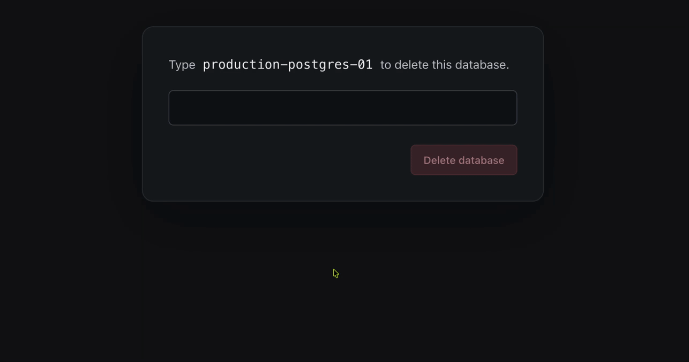
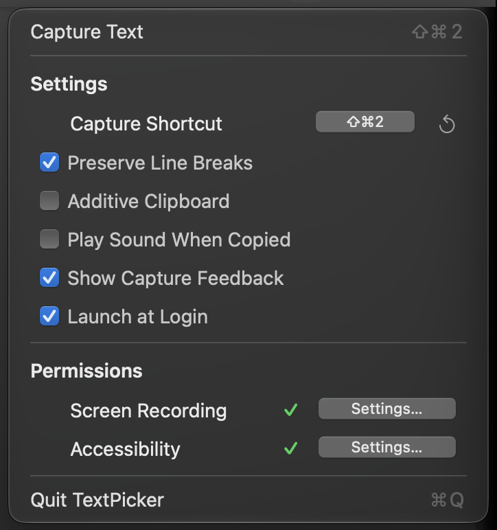

# TextPicker

**Select a region. Copy its text.** Local OCR for Apple Silicon Macs.

Press **⌘⇧2**, drag over text, and paste anywhere. No account, cloud processing,
or capture uploads.



[**Download for Apple Silicon**](https://github.com/georgiansarghi/TextPicker/releases)

Ad-hoc signed, not notarized. macOS may block the download.
Grant **Screen Recording** and **Accessibility** when prompted.

- Menu-preserving selection, configurable shortcut and optional feedback.
- Preserve line breaks or collect successive captures with Additive Clipboard.
- Native PP-OCRv6 Small inference. Opt-in launch at login.



## Build & run

Requires Xcode, CMake and `uv`. The first build downloads and verifies the pinned
model pack; the installed app works offline.

```sh
bash scripts/setup.sh
bash scripts/build.sh
open .build/apps/TextPicker.app
```

[Building](docs/BUILDING.md) · [Tests & limitations](docs/TESTING.md) · [Releases](docs/RELEASING.md) · [Notices](licenses/THIRD_PARTY.md)
